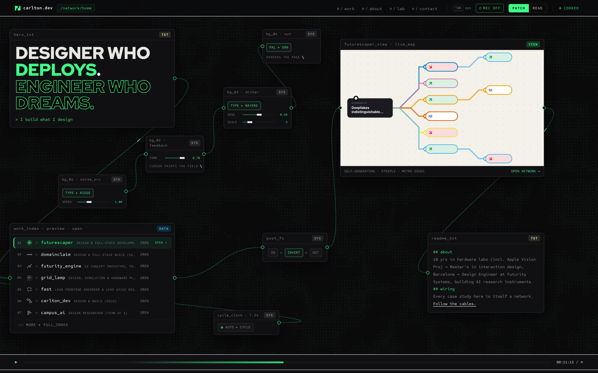
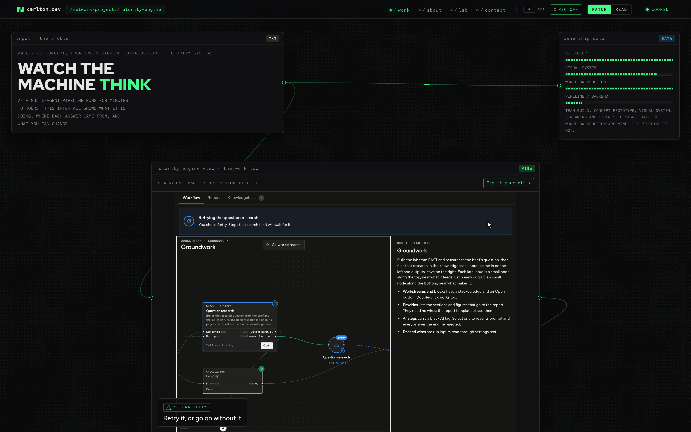
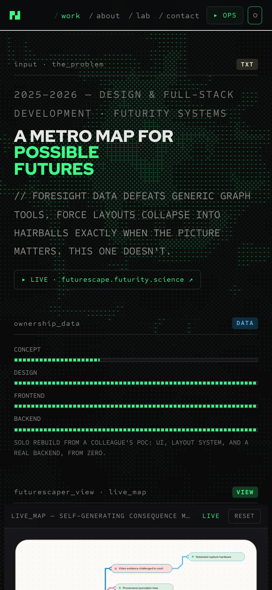

# carlton.dev

The portfolio of Carlton Lindsay, design engineer. Every page is a live dataflow network.

[](https://carlton.dev/?utm_source=github&utm_campaign=site-repo)

Content sits in operators, and cables connect them. The cables are real: selecting a project sends a message down the wire and the operators downstream update. The background is generated by four operators you can see and adjust on the home page.

**Live site:** [carlton.dev](https://carlton.dev/?utm_source=github&utm_campaign=site-repo)

## Case studies

Each case study is a network of its own, with a working demo of the product inside it.

| Case study | In one line |
|---|---|
| [Futurescaper](https://carlton.dev/projects/futurescaper/?utm_source=github&utm_campaign=site-repo) | A metro map for possible futures |
| [DomainClaim](https://carlton.dev/projects/domainclaim/?utm_source=github&utm_campaign=site-repo) | Proof you can watch |
| [Futurity Engine](https://carlton.dev/projects/futurity-engine/?utm_source=github&utm_campaign=site-repo) | Watch the machine think |
| [GRID](https://carlton.dev/projects/grid-lamp/?utm_source=github&utm_campaign=site-repo) | A lamp you sculpt by touch |
| [FAST](https://carlton.dev/projects/fast/?utm_source=github&utm_campaign=site-repo) | The research platform behind the engine |
| [carlton.dev](https://carlton.dev/projects/carlton-dev/?utm_source=github&utm_campaign=site-repo) | This site, built as a live patch |
| [Campus AI](https://carlton.dev/projects/campus-ai/?utm_source=github&utm_campaign=site-repo) | Research on how people learn with AI |

<p>
  
  
</p>

## A five-minute tour

1. Open [carlton.dev](https://carlton.dev/?utm_source=github&utm_campaign=site-repo) on a screen at least 1280px wide.
2. Move the pointer. It paints heat into the background.
3. Hover a row in `work_index`. The viewer beside it switches to that project.
4. Drag an operator by its header. The cables follow.
5. Change a slider on `bg_02 · feedback` or cycle the `TYPE` chip on `bg_01 · noise_src`. The background changes at once and the setting is remembered.
6. Click a nav link. A ring spreads from the click and the next page wires itself in.
7. Press `P` for READ mode. The same content becomes a plain document.
8. Open the Futurescaper case study and use the demo.

## What I did

I designed and built the site on my own.

- **The design system.** Operators, ports, cables and two modes (PATCH and READ). The grammar comes from node-based tools like TouchDesigner.
- **The patch runtime.** A small message bus with no framework. One line declares a cable, and that line both draws it and subscribes the operator at the far end.
- **The layout resolver.** Every page except home describes its layout as flexbox: rows of cards, each centred, spread or indented by one word, and the browser lays them out, so the gap between rows is the same everywhere. Home keeps its hand-made ASCII sketch, which the resolver places, snaps to the dot grid and moves apart if operators overlap.
- **The background.** A noise source, a feedback buffer, a dither stage and an output, drawn to one canvas that stays in place across pages.
- **Page changes.** A front of heat crosses the background, the new page is revealed behind it, and the cables draw in.
- **The demos.** Each case study rebuilds part of the real product inside the page, in that product's own visual language.
- **The copy.** Every role, date and number is checked against what happened.

## Stack

| Part | What it uses |
|---|---|
| Site | Astro 7, static output |
| Styling | Tailwind 4, with design tokens in `src/styles/tokens.css` |
| Patch runtime, layout, cables | Vanilla JavaScript, served as one cached file |
| Background | Canvas 2D |
| Cables | SVG |
| Page changes | The View Transitions API, through Astro's client router |
| Demos | React 19 islands, loaded only on the pages that have them |
| 3D (Grid Lamp) | Three.js, loaded only when that project is on screen |
| Type | Red Hat Display and Sometype Mono, self-hosted |
| Tests | Playwright |
| Hosting | GitHub Pages, deployed by GitHub Actions |
| Contact form | Vercel functions in `mail/`, sending through Resend |

The home page ships almost no framework JavaScript.

## Run it

You need Node 22.

```bash
git clone https://github.com/Carlton-L/Carlton-L.github.io.git
cd Carlton-L.github.io
npm install
npm run dev
```

The dev server prints its address (usually `http://localhost:4321`).

| Command | What it does |
|---|---|
| `npm run dev` | Start the dev server |
| `npm run build` | Build the static site into `dist/` |
| `npm run preview` | Serve the built site |
| `npm run test:unit` | Run the unit tests in Node (no build, under a second) |
| `npm test` | Unit tests, then build, then drive a real browser over the result |

The tests need the browsers once: `npx playwright install`. To run all three engines: `BROWSERS=chromium,firefox,webkit npm test`.

## Where things are

| Path | What is there |
|---|---|
| `src/pages/` | One file per page. Case studies are in `src/pages/projects/` |
| `src/components/PatchField.astro` | The network's markup and styles |
| `src/lib/patch-field.js` | The network's script: background, cables, layout, page changes |
| `src/components/Operator.astro` | One content block |
| `src/lib/patch-runtime.js` | The message bus behind the cables |
| `src/lib/previs.js` | The previews shown in the work index viewer |
| `src/components/react/demos/` | The case-study demos |
| `src/data/content.js` | All project and case-study copy |
| `src/styles/` | Tokens, fonts and global styles |
| `src/lib/page-clock.js` | The clock every page change runs on |
| `src/lib/warm.js` | Fetches the next page and its stylesheets before the click |
| `tests/unit/` | Unit tests for the message bus, the clock, early fetching and demo hydration |
| `tests/built/` | Checks on the built site |
| `tests/transitions.mjs` | The browser tests |
| `tests/measure.mjs` | Times how fast a page change starts |
| `mail/` | The contact form's server functions, deployed on their own to Vercel. See `mail/README.md` |
| `docs/` | Notes on the patch system, the demos and the case-study format |
| `docs/readme/` | The screenshots in this README |

## How it works

- **Two modes.** PATCH is the spatial network, for screens 1280px and wider. READ is a linear document. Smaller screens and visitors who ask for reduced motion get READ.
- **Cables are subscriptions.** A link such as `['opIndex:selection', 'opFx']` draws a cable and routes the `selection` message along it. Each delivery pulses the cable that carried it.
- **Nothing runs on the bus per frame.** Messages are sent when a visitor does something. The background and the cables animate in their own loops.
- **Everything is torn down between pages.** Timers, listeners and observers are registered through the runtime, which removes them before the next page arrives.
- **One background, kept across pages.** The canvas is fixed to the viewport, so it stays put through navigation and resize.
- **Deploys on push.** A push to `astro` builds the site and publishes it. See `.github/workflows/deploy.yml`.

## License

MIT
